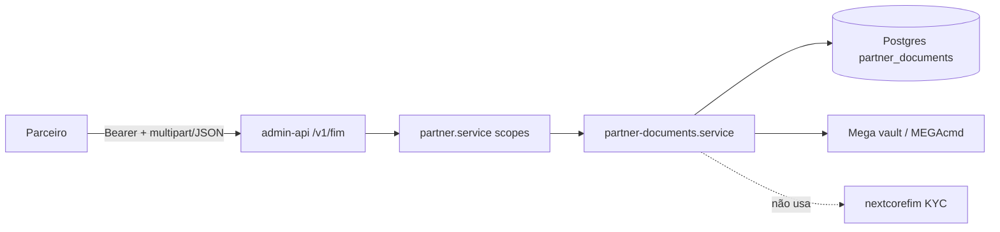

# TechSpec — Documentos do parceiro (Mega)

| Campo       | Valor                                                                                                                                                            |
| ----------- | ---------------------------------------------------------------------------------------------------------------------------------------------------------------- |
| Versão      | 0.1                                                                                                                                                              |
| Data        | 2026-11-19                                                                                                                                                       |
| Entrada     | [PRD-PARTNER-DOCUMENTS-MEGA-2026-11.md](./PRD-PARTNER-DOCUMENTS-MEGA-2026-11.md)                                                                                 |
| Complementa | `API.md` e `AGENTS.md` (workspace admin-index-core, fora deste repo; `API.md` será adicionado em PD-05) · [partners/ipe-core-fim.md](./partners/ipe-core-fim.md) |
| Escopo MVP  | `admin-backend` (`api/`) — rotas `/v1/fim/.../documents`, Prisma, cliente Mega                                                                                   |
| Escopo docs | `docs/partners/*`, `api/docs/partners/*`, `docs/API.md`; opcional `web/` catálogo api-docs                                                                       |
| Fora do MVP | UI admin, nextcorefim/KYC slots, S3 `documents`                                                                                                                  |
| Precedência | PRD = _o quê_; TechSpec = _como_. Em conflito de contrato HTTP/modelo, **esta TechSpec vence**.                                                                  |

**Regras de agente:** commits inglês, Conventional Commits, autor único Thiago; **proibido** `Co-authored-by`. Push `origin` + `personal` no repo da API. Deploy dl3809 só com aprovação explícita.

---

## 1. Objetivo técnico

Entregar CRUD server-to-server de anexos genéricos para o parceiro FIM, gravando bytes no Mega (pasta dedicada) e metadados no Postgres OpCore, sem passar pelo checklist KYC do nextcorefim.

---

## 2. Arquitetura

```text
Parceiro (backend Ipebank)
  Authorization: Bearer opc_…
        │
        ▼
  api.admin.opcore.com.br  (Express)
        ├─ requirePartner + rate limit + logPartnerAccess
        ├─ requireScope(fim.documents.read|write)
        ├─ partner-documents.service
        │     ├─ resolveOrCreatePartyCotista
        │     ├─ Prisma PartnerDocument
        │     └─ lib/mega (vault HTTP e/ou MEGAcmd)
        └─ Postgres OpCore
              └─ Mega (pasta opcore/partner-docs/…)
```



**Não** chamar `nextcorefimClient.uploadDocument` nem `POST /files/fim/:cotistaId/documents`. Esses fluxos exigem `slot` e pastas de Application FIM.

---

## 3. Decisões técnicas (ADRs)

### D-1 — Metadados no OpCore, bytes no Mega

**Decisão:** tabela `partner_documents` + cliente Mega no admin-api.

**Por quê:** isolamento por `partnerId`, auditoria, CRUD sem poluir `ApplicationDocument` do nextcorefim.

### D-2 — Auto-create só no POST

**Decisão:**

| Operação                                | Party/Cotista ausente                                                 |
| --------------------------------------- | --------------------------------------------------------------------- |
| `POST`                                  | Cria Party + Cotista (`excludeFromPl: true`); exige campo form `name` |
| `GET` lista / `GET` download / `DELETE` | `404` `{ "error": "Cotista não encontrado" }`                         |

**Por quê:** evitar party fantasma em listagens/erros de CPF.

### D-3 — Multipart parseado no admin-api

**Decisão:** `multer` memoryStorage (1 arquivo, 12 MB) nos handlers POST — não proxy raw como o KYC FIM.

Campos form:

| Campo       | Obrigatório           | Notas                                         |
| ----------- | --------------------- | --------------------------------------------- |
| `file`      | sim                   | binário                                       |
| `name`      | só se for criar party | `legalName`                                   |
| `cotistaId` | não                   | UUID; se presente, deve bater com `:document` |
| `label`     | não                   | máx. 120 chars, trim                          |

### D-4 — Escopos novos no array existente

**Decisão:** estender `FIM_PARTNER_SCOPES` em `partner.service.ts`:

- `fim.documents.write`
- `fim.documents.read`

`normalizePartnerScopes` passa a aceitá-los. Atualizar scopes do parceiro Ipe Core via SQL/`partner-admin` (CLI hoje só create/rotate token — se não houver update de scopes no CLI, usar rota admin ou `UPDATE api_partners SET scopes = …` documentado na Fase 0).

### D-5 — Pasta Mega e system

```text
system (vault): opcore
folder:         partner-docs/{partnerId}/{cpfCnpj}
remote file:    {fileId}__{safeOriginalName}
```

Path lógico completo (MEGAcmd): `/opcore/partner-docs/{partnerId}/{cpfCnpj}/{fileId}__{safeOriginalName}` — alinhar ao `megaRemoteDir` do nextcorefim/IndexCore (root + system + folder).

`fileId` = UUID gerado **antes** do upload, para o nome remoto ser estável e igual ao PK.

### D-6 — Hard delete

**Decisão:** MVP hard-delete (Mega + row). Sem `deletedAt`.

### D-7 — Auditoria em duas camadas

1. `ApiPartnerRequestLog` via `logPartnerAccess` (já nas rotas FIM).
2. `AuditLog` com `userId: null`, `action`: `partner.documents.upload|list|download|delete`, `entityType: 'partner_document'`, `entityId: fileId` (lista: `entityId` = partyId), `details`: `{ partnerId, partyId, cotistaId, document }`, `ipAddress`.

---

## 4. Modelo de dados

### 4.1 Prisma — `PartnerDocument`

Arquivo sugerido: `api/prisma/schema.prisma` (bloco EXTERNAL PARTNERS).

```prisma
model PartnerDocument {
  id           String   @id @default(uuid()) @db.Uuid
  partnerId    String   @map("partner_id") @db.Uuid
  partyId      String   @map("party_id") @db.Uuid
  cotistaId    String   @map("cotista_id") @db.Uuid
  label        String?  @db.VarChar(120)
  originalName String   @map("original_name") @db.VarChar(255)
  mimeType     String   @map("mime_type") @db.VarChar(100)
  size         Int
  sha256       String   @db.VarChar(64)
  megaId       String   @map("mega_id") @db.VarChar(128)
  megaPath     String   @map("mega_path") @db.VarChar(1024)
  createdAt    DateTime @default(now()) @map("created_at") @db.Timestamptz

  partner ApiPartner @relation(fields: [partnerId], references: [id], onDelete: Cascade)
  party   Party      @relation(fields: [partyId], references: [id], onDelete: Cascade)
  cotista Cotista    @relation(fields: [cotistaId], references: [id], onDelete: Cascade)

  @@unique([partnerId, partyId, sha256])
  @@index([partnerId, partyId])
  @@index([cotistaId])
  @@map("partner_documents")
}
```

Relações a acrescentar:

- `ApiPartner.partnerDocuments PartnerDocument[]`
- `Party.partnerDocuments PartnerDocument[]`
- `Cotista.partnerDocuments PartnerDocument[]`

Migration: `prisma migrate` com nome `partner_documents`.

**Unique `(partnerId, partyId, sha256)`:** dedup — segundo upload idêntico retorna o registro existente sem novo put no Mega.

### 4.2 Party / Cotista na criação (espelho subscription)

Ao criar no POST (sem party):

```ts
party: {
  type: document.length <= 11 ? 'pf' : 'pj',
  cpfCnpj: document, // só dígitos
  legalName: name,
  status: 'aprovado',
  riskLevel: 'baixo',
  pepFlag: false,
  excludeFromPl: true,
  approvedAt: new Date(),
}
cotista: { partyId }
```

Não criar `PartyFundLink` nem subscription neste fluxo.

---

## 5. Contrato HTTP

Base: `https://api.admin.opcore.com.br`  
Auth: `Authorization: Bearer opc_…`  
Rate limit: `rateLimitRpm` do parceiro; `429` + `Retry-After`.  
Header `X-Fim-Dry-Run`: **ignorado** nestas rotas (documentar).

### 5.1 `POST /v1/fim/shareholders/:document/documents`

- Escopo: `fim.documents.write`
- Body: `multipart/form-data` (acima)
- `:document`: 11 ou 14 dígitos (normalizar strip non-digits; se path vier mascarado, aceitar e normalizar)

**201** (novo):

```json
{
  "id": "<uuid>",
  "document": "12345678901",
  "cotistaId": "<uuid>",
  "partyId": "<uuid>",
  "label": "comprovante",
  "originalName": "comprovante.pdf",
  "mimeType": "application/pdf",
  "size": 102400,
  "sha256": "<64 hex>",
  "createdAt": "2026-11-19T12:00:00.000Z",
  "created": true
}
```

**200** (dedup): mesmo shape com `"created": false`.

### 5.2 `GET /v1/fim/shareholders/:document/documents`

- Escopo: `fim.documents.read`
- Query opcional: `cotistaId`

**200:** shape do PRD §RF05 (`items[]` sem `megaId`/`megaPath`).

### 5.3 `GET /v1/fim/shareholders/:document/documents/:fileId`

- Escopo: `fim.documents.read`
- Query: `disposition=inline|attachment` (default `attachment`)
- Resposta: body binário + `Content-Type` + `Content-Disposition`
- Filtro: `id = fileId AND partnerId AND partyId` resolvido

### 5.4 `DELETE /v1/fim/shareholders/:document/documents/:fileId`

- Escopo: `fim.documents.write`
- **200:**

```json
{
  "ok": true,
  "id": "<uuid>",
  "document": "12345678901",
  "cotistaId": "<uuid>",
  "partyId": "<uuid>"
}
```

### 5.5 Erros

| HTTP | Quando                                                                                           |
| ---- | ------------------------------------------------------------------------------------------------ |
| 400  | document inválido; MIME/tamanho; `name` ausente na 1ª criação; multipart inválido; `label` > 120 |
| 401  | Bearer inválido/ausente                                                                          |
| 403  | Escopo ausente                                                                                   |
| 404  | Cotista/party não encontrado (GET/DELETE); arquivo não encontrado / outro parceiro               |
| 409  | `cotistaId` existe mas CPF/CNPJ diverge do path                                                  |
| 429  | Rate limit                                                                                       |
| 502  | Mega falhou (rede/API)                                                                           |
| 503  | Mega não configurado no env                                                                      |

Corpo de erro JSON alinhado ao FIM: `{ "error": "<mensagem em português>" }`.

### 5.6 MIME e tamanho

```ts
const ALLOWED = new Set(['application/pdf', 'image/jpeg', 'image/png', 'image/webp']);
const MAX_BYTES = 12 * 1024 * 1024;
```

---

## 6. Módulos e arquivos

| Path                                                         | Responsabilidade                                                                                                        |
| ------------------------------------------------------------ | ----------------------------------------------------------------------------------------------------------------------- |
| `api/prisma/schema.prisma` + migration                       | `PartnerDocument` + relations                                                                                           |
| `api/src/lib/env.ts`                                         | `megaVaultUrl`, `megaVaultApiKey`, `megaEmail`, `megaPassword`, `megacmdContainer?`                                     |
| `api/src/lib/mega/folder.ts`                                 | `sanitizeFileName`, `partnerDocsFolder(partnerId, document)`, path helpers                                              |
| `api/src/lib/mega/cmd.ts`                                    | MEGAcmd exec (copiar padrão IndexCore/nextcorefim se conta configurada)                                                 |
| `api/src/lib/mega/client.ts`                                 | `uploadPartnerFile`, `downloadPartnerFile`, `deletePartnerFile`; vault preferido se só vault; conta se `MEGA_EMAIL` set |
| `api/src/services/partner.service.ts`                        | constantes de escopo                                                                                                    |
| `api/src/services/partner-documents.service.ts`              | resolução identidade, CRUD, dedup, audit                                                                                |
| `api/src/routes/fim-partner-documents.routes.ts`             | 4 rotas + multer                                                                                                        |
| `api/src/routes/fim-partner.routes.ts` **ou** `v1.routes.ts` | `registerFimPartnerDocumentRoutes(app, guards)`                                                                         |
| `api/src/services/partner-documents.service.test.ts`         | unit                                                                                                                    |
| `api/src/routes/fim-partner-documents.routes.test.ts`        | HTTP                                                                                                                    |
| `docs/partners/ipbank-routes.md`                             | guia banco                                                                                                              |
| `api/docs/partners/ipe-core-fim.md`                          | espelho                                                                                                                 |
| `docs/API.md`                                                | tabela `/v1`                                                                                                            |
| `web/src/features/api-docs/data.ts`                          | se listar FIM (opcional no mesmo PR ou follow-up)                                                                       |
| `api/prisma/partner-cli.ts`                                  | exemplo de scopes no help string                                                                                        |

**Preferência de cliente Mega:** copiar/adaptar `nextcorefunds/nextcorefim/api/src/services/mega/{client,cmd,folder}.ts` (já battle-tested) em vez do proxy nextcorefim.

---

## 7. Fluxos

### 7.1 Upload

```text
1. Auth + scope write
2. Normalizar :document
3. Parse multer (file + fields)
4. Validar MIME/size/label
5. resolveIdentity:
   - se cotistaId → load cotista+party; cpf deve == document senão 409
   - senão find party by cpfCnpj + deletedAt null
   - se sem party → exigir name; create party+cotista
   - se party sem cotista → create cotista
6. sha256 = hash(buffer)
7. findUnique partnerId+partyId+sha256 → se hit, return 200 created:false
8. fileId = randomUUID()
9. upload Mega (folder partner-docs/…)
10. insert PartnerDocument (se falhar → best-effort delete Mega → 500)
11. AuditLog upload
12. 201 created:true
```

### 7.2 List / Download / Delete

```text
1. Auth + scope
2. resolveIdentityStrict (sem create) → 404 se ausente
3. Se query cotistaId, mesma regra 409
4. Query PartnerDocument where partnerId + partyId (+ id)
5. List: map DTO
   Download: downloadFromMega(megaId) → stream/buffer
   Delete: deleteFromMega → delete row → audit
```

---

## 8. Env / deploy

No `.env` da API no `dl3809` (`~/projects/opcore/api`):

| Variável                       | Uso                                    |
| ------------------------------ | -------------------------------------- |
| `MEGA_VAULT_URL`               | Base vault (sem trailing slash)        |
| `MEGA_VAULT_API_KEY`           | Header `X-Api-Key`                     |
| `MEGA_EMAIL` / `MEGA_PASSWORD` | Alternativa MEGAcmd (se vault ausente) |
| `MEGACMD_CONTAINER`            | Só dev local com docker exec           |

Regra: se nenhum modo configurado → rotas de documentos respondem `503`. API sobe normalmente (mesmo padrão nextcorefim key vazia).

Pós-deploy:

1. `prisma migrate deploy` (já no `deploy.sh`)
2. Atualizar `scopes` do ApiPartner Ipe Core incluindo os dois novos
3. Smoke upload QA com CPF `excludeFromPl`

---

## 9. Testes

### Unit (`partner-documents.service.test.ts`)

- Normaliza CPF mascarado
- Cria party+cotista no primeiro upload; segundo upload reusa
- `cotistaId` divergente → erro 409
- Dedup por sha256 sem chamar Mega de novo
- List/delete isolam por `partnerId`
- MIME inválido / size → 400
- Mega down no upload → 502, sem row

### Rotas (`fim-partner-documents.routes.test.ts`)

Padrão de `fim-partner.routes.test.ts` (app + `x-test-partner`):

- Sem token → 401
- Sem scope → 403
- POST com scope write → 201
- GET sem scope read → 403
- DELETE remove e segundo GET file → 404

Mocks: Prisma + `lib/mega/client`.

### Manual / smoke

Script opcional `api/scripts/smoke-partner-documents.ts` (token + CPF QA) — não obrigatório no CI.

---

## 10. Docs parceiro (diff esperado)

Na tabela “O que este token pode consumir”, acrescentar:

| Método   | Rota                                               | Escopo                |
| -------- | -------------------------------------------------- | --------------------- |
| `POST`   | `/v1/fim/shareholders/:document/documents`         | `fim.documents.write` |
| `GET`    | `/v1/fim/shareholders/:document/documents`         | `fim.documents.read`  |
| `GET`    | `/v1/fim/shareholders/:document/documents/:fileId` | `fim.documents.read`  |
| `DELETE` | `/v1/fim/shareholders/:document/documents/:fileId` | `fim.documents.write` |

Seção nova: anexos genéricos (Mega), auto-create, MIME/12 MB, sem dry-run, exemplos `curl` multipart.

**Não** reutilizar a seção de KYC admin.

---

## 11. Ordem de implementação (PRs)

| PR  | Conteúdo                                          | Critério de pronto                           |
| --- | ------------------------------------------------- | -------------------------------------------- |
| 1   | Prisma model + migration + scopes consts          | migrate local OK; testes de normalize scopes |
| 2   | `lib/mega` + env                                  | unit client com fetch/cmd mockados           |
| 3   | `partner-documents.service` + testes              | cobertura fluxos §7                          |
| 4   | Rotas + multer + register                         | testes HTTP verdes                           |
| 5   | Docs parceiro + API.md (+ api-docs web se couber) | guia atualizado                              |
| ops | env Mega no servidor + scopes do token Ipe Core   | smoke real                                   |

PRs pequenos; não misturar UI admin.

---

## 12. Critérios de aceite técnicos

- [ ] Quatro rotas registradas atrás de `requirePartner` + scope + `logPartnerAccess`
- [ ] Nenhum import de `nextcorefim/fim-documents` neste fluxo
- [ ] Unique dedup `(partnerId, partyId, sha256)` ativo
- [ ] Pasta Mega sob `partner-docs/`, não sob application KYC
- [ ] `excludeFromPl: true` em party criado só por upload
- [ ] CI: lint, typecheck, test, build da API

---

## 13. Riscos e mitigação (implementação)

| Risco                                    | Mitigação                                                                                                   |
| ---------------------------------------- | ----------------------------------------------------------------------------------------------------------- |
| Multer + `express.json` global           | Registrar raw/multipart só nestas rotas; não alterar parser global                                          |
| Órfão Mega se insert falhar              | try/catch + `deletePartnerFile` best-effort                                                                 |
| Órfão DB se Mega delete falhar no DELETE | Preferir: delete Mega primeiro; se 404 Mega, ainda apaga row; se Mega 502, não apaga row e devolve 502      |
| Update de scopes sem CLI                 | Documentar SQL/`partner-admin` na Fase 0; opcional follow-up CLI `partner:scopes`                           |
| Token em claro nos guias                 | Manter comportamento atual dos guias; novos exemplos podem usar `opc_…` placeholder se o time limpar depois |

---

## 14. Referências de código

- Rotas FIM: `api/src/routes/fim-partner.routes.ts`, `v1.routes.ts`
- Escopos: `api/src/services/partner.service.ts`
- Create party subscription: `api/src/services/fim-subscription.service.ts` (~L439+)
- KYC Mega proxy (não copiar contrato): `api/src/routes/files.routes.ts`, `api/src/lib/nextcorefim/*`
- Cliente Mega referência: `nextcorefunds/nextcorefim/api/src/services/mega/*`
- Vault HTTP: `nextcorefunds/mega/README.md`
